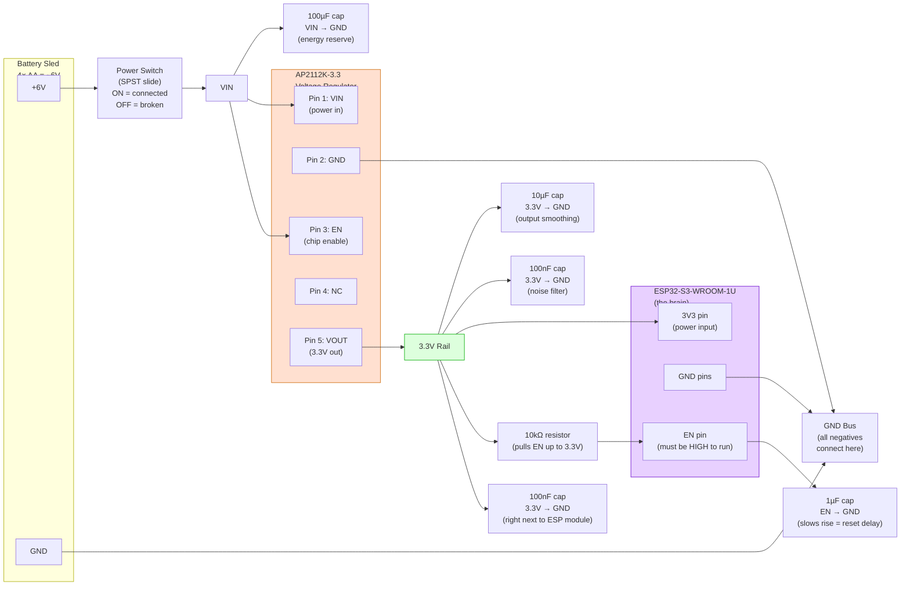
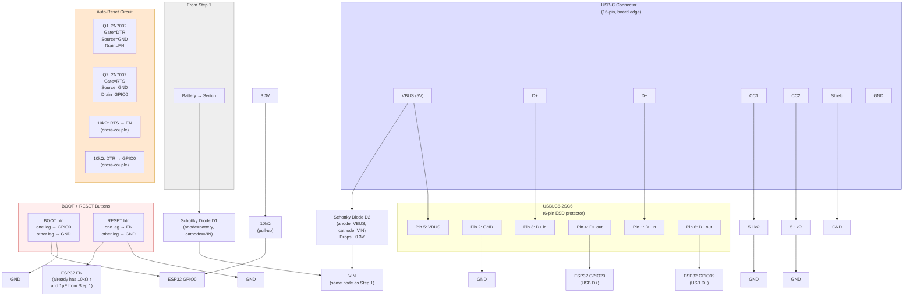
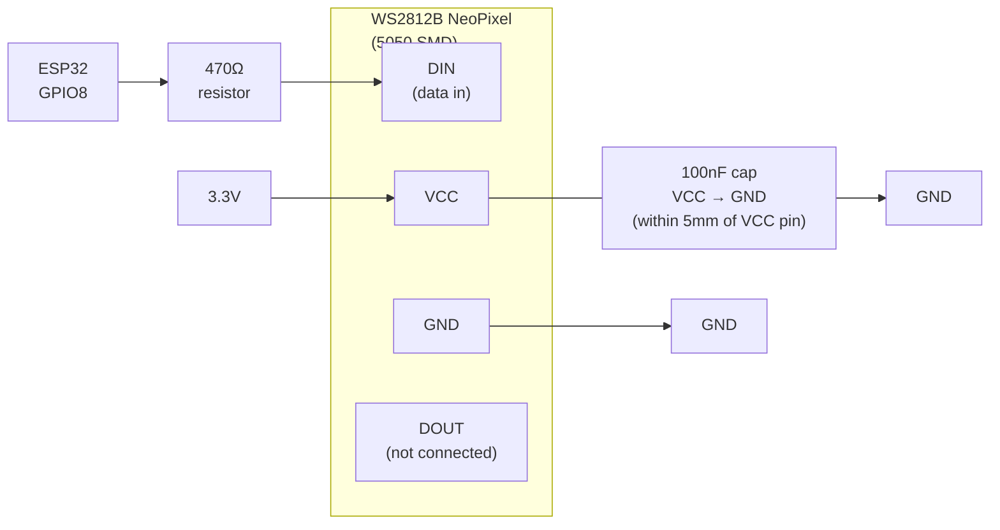
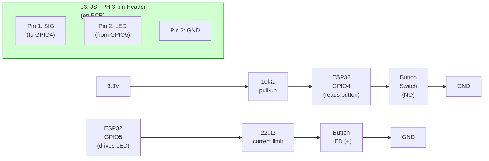
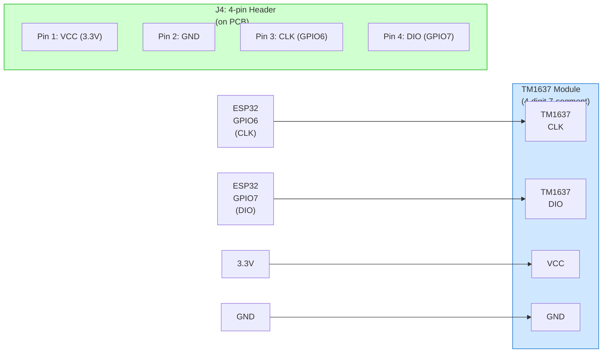
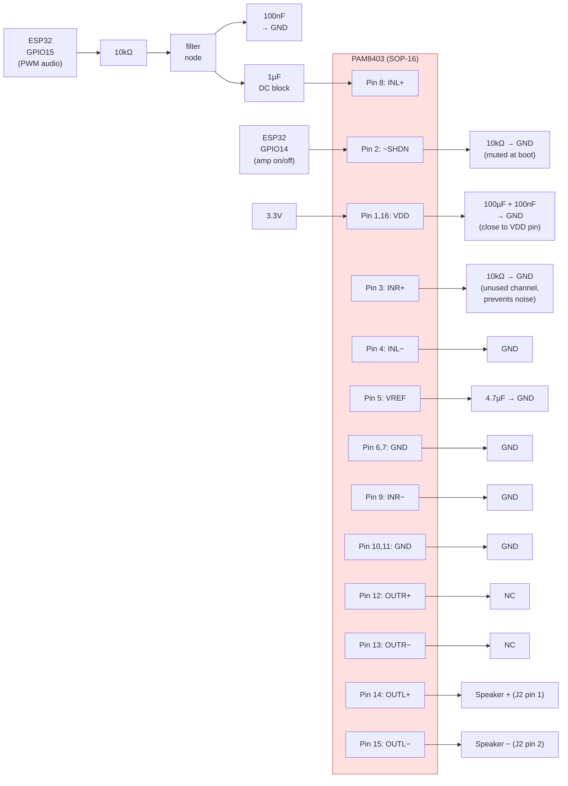
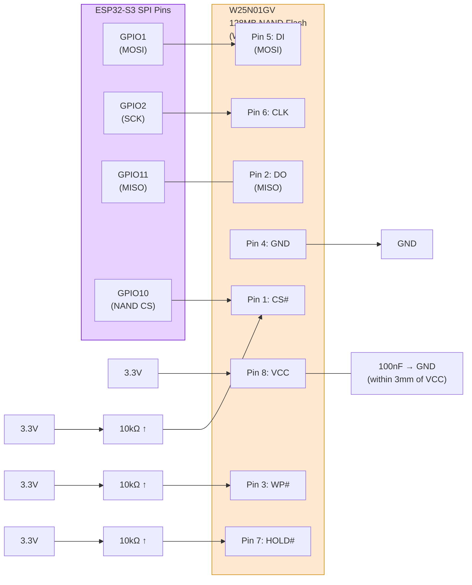
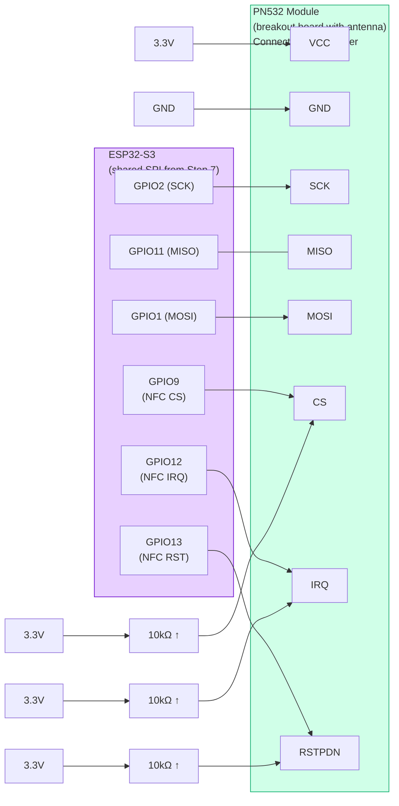

# Hub Schematic Build — Step by Step

> **Goal:** Build the Central Hub V1 schematic in EasyEDA Pro, one circuit block at a time. Each step adds one testable piece. Complete a step before moving to the next.
>
> **Module:** ESP32-S3-WROOM-1U-N16R8 (LCSC C3013946) — U.FL antenna variant
>
> **References:** [hub-pcb-design-brief.md](hub-pcb-design-brief.md) · [hub-bom.md](../bom/hub-bom.md)

---

## Progress

| # | Block | Status | Components | Test |
|---|-------|--------|------------|------|
| 1 | ESP32 + Power | � | Module, LDO, caps, battery, switch | Apply power → module boots (no verification yet) |
| 2 | USB-C | 📝 | Connector, ESD, CC resistors, auto-reset | Plug USB → computer sees device |
| 3 | NeoPixel LED | 📝 | WS2812B, 470Ω, 100nF | Flash firmware → LED blinks color |
| 4 | Pairing Button | 📝 | Pushbutton, 10kΩ, LED resistor | Press button → NeoPixel changes color |
| 5 | TM1637 7-Segment | 📝 | Module, 4-pin header | Display a number |
| 6 | Audio (PAM8403) | 📝 | Amp, RC filter, caps, speaker | Play a tone through speaker |
| 7 | SPI + NAND Flash | 📝 | W25N01GV, CS pull-up, decoupling | Read/write test data |
| 8 | NFC Reader | 📝 | PN532 module, header, CS/IRQ pull-ups | Detect an NFC card |

---

## ESP32-S3 Pin Constraints (Reference)

Before we assign any GPIO, know what's off-limits on the N16R8 module:

- **GPIO26–32, GPIO33–37:** NOT AVAILABLE — used internally for Octal SPI flash/PSRAM
- **GPIO0:** Strapping pin. Must be HIGH at boot (normal mode). We'll use it for the BOOT button (step 2).
- **GPIO3:** Strapping pin (JTAG). Avoid for general I/O.
- **GPIO45:** Strapping pin (VDD_SPI). Must stay LOW. Do NOT use.
- **GPIO46:** Strapping pin (boot mode). Input-only, must stay LOW. Do NOT use.
- **GPIO19/20:** Reserved for native USB D−/D+ (step 2).
- **GPIO43/44:** Default UART0 TX/RX (serial console). Useful for debug — leave free.

**ESP32-S3 has NO DAC** (unlike the original ESP32). Audio uses PWM → filter (step 6).

---

## GPIO Assignment (Updated as we go)

| GPIO | Function | Added In | Notes |
|------|----------|----------|-------|
| EN | Reset (10kΩ ↑ + 1µF) | Step 1 | Power-on reset. Button added in Step 2. |
| 0 | BOOT button | Step 2 | 10kΩ pull-up. |
| 19 | USB D− | Step 2 | Native USB peripheral. |
| 20 | USB D+ | Step 2 | Native USB peripheral. |
| | | | |

*More rows added with each step.*

---

## Step 1: ESP32 Module + Power

### What are we building?

The absolute minimum to make the ESP32-S3 turn on. Battery goes in, power switch flips, voltage regulator converts 6V down to 3.3V, and the ESP32 module gets power. That's it. No USB, no peripherals, just "the brain has electricity."

### Components in this step

| Part | What it does | LCSC / Source |
|------|-------------|---------------|
| ESP32-S3-WROOM-1U-N16R8 | The brain. Does everything. | C3013946 |
| AP2112K-3.3TRG1 | Voltage regulator. Takes 6V in, outputs steady 3.3V. | Search LCSC |
| 4× AA Battery Sled | Provides ~6V. Wired, not on PCB. | AliExpress |
| SPST Slide Switch | On/off switch in the battery line. | AliExpress |
| 10µF ceramic capacitor | Smooths the 3.3V output. | 0603, LCSC Basic |
| 100nF ceramic capacitor (×2) | Filters high-frequency noise near the ESP32. | 0402, LCSC Basic |
| 100µF electrolytic capacitor | Stores energy on the input side for current spikes. | Radial TH or SMD |
| 10kΩ resistor | Pull-up on the EN (enable/reset) pin. | 0402, LCSC Basic |
| 1µF ceramic capacitor | Pairs with the 10kΩ to delay the reset signal at power-on. | 0402, LCSC Basic |

### How it connects — plain English

1. **Battery (+6V)** goes through the **power switch** to the **input** of the voltage regulator.
2. The **100µF big cap** sits right next to the regulator input to handle current surges.
3. The **voltage regulator** (AP2112K) drops 6V to a steady **3.3V** at its output.
4. Two small caps (**10µF** and **100nF**) sit right at the regulator output to keep the 3.3V clean.
5. That 3.3V rail goes to the **ESP32 module's 3V3 pin** (this is how the chip eats).
6. All the **GND** (ground/negative) pins from every component connect together — battery negative, regulator GND, ESP32 GND, all capacitor negatives. Ground is the "common return path" for all current.
7. The ESP32's **EN (enable) pin** needs to be held HIGH for the chip to run. A **10kΩ resistor** pulls it up to 3.3V. A **1µF capacitor** to GND slows down how fast EN rises at power-on, giving the power supply time to stabilize before the chip tries to start. This is called a "power-on reset delay."

### The diagram



### Pin-by-pin: AP2112K-3.3 (5-pin SOT-23-5)

This is a tiny chip with 5 legs. Here's what each one connects to:

| Pin | Label | What to connect | Why |
|-----|-------|----------------|-----|
| 1 | VIN | Wire from battery (after switch) | This is where the 6V comes in |
| 2 | GND | Ground plane | Return path for all current |
| 3 | EN | Wire to VIN (or to pin 1) | EN = "enable." Tying it to VIN means the regulator turns on whenever there's battery power. |
| 4 | NC | Nothing! Leave it floating. | "No Connect" — this pin does nothing |
| 5 | VOUT | 3.3V rail → to ESP32 3V3 | This is the clean 3.3V output |

### Pin-by-pin: ESP32-S3-WROOM-1U-N16R8 (for this step only)

The module has ~40 pins. **In this step, we only care about 3 of them.** Everything else stays unconnected for now.

| Pin | Label | What to connect | Why |
|-----|-------|----------------|-----|
| 3V3 | Power in | 3.3V rail from regulator | Feeds the chip |
| GND | Ground | Ground plane (multiple GND pins — connect ALL of them) | Return path |
| EN | Enable / Reset | 10kΩ resistor to 3.3V, and 1µF cap to GND | HIGH = chip runs. The RC combo gives a clean startup. We'll add a RESET button here in Step 2. |

**All other GPIO pins:** Leave unconnected for now. We'll wire them in later steps.

### What about GPIO0 (the boot pin)?

GPIO0 has an **internal pull-up** inside the module. At power-on, if GPIO0 is floating (unconnected), it reads HIGH, and the chip boots normally. We don't need to touch it until Step 2 when we add the BOOT button.

### Capacitor placement rules

This is the most important layout thing in this step:

- **100µF electrolytic:** Place within 10mm of the AP2112K VIN pin (pin 1)
- **10µF ceramic:** Place within 5mm of the AP2112K VOUT pin (pin 5)
- **100nF ceramic (regulator):** Place within 3mm of VOUT pin (pin 5) — even closer than the 10µF
- **100nF ceramic (ESP32):** Place within 5mm of the ESP32 module's 3V3 pin
- **1µF (EN reset):** Place close to the EN pin of the ESP32 module

Why so close? Capacitors only work well at filtering noise if the wire path (trace) between them and the pin they're protecting is short. A long trace adds inductance that defeats the purpose.

### EasyEDA steps

1. **Start a new project** in EasyEDA Pro
2. **Place the ESP32-S3-WROOM-1U-N16R8**: Search LCSC part C3013946 → Place Component. This is a big module with lots of pins. Don't panic — most stay empty.
3. **Place the AP2112K-3.3**: Search LCSC for "AP2112K-3.3" → Place Component
4. **Place the capacitors**: Search LCSC for generic 100nF 0402, 10µF 0603, 1µF 0402 ceramics, and one 100µF electrolytic. Place them near their respective chips.
5. **Place the 10kΩ resistor**: 0402 size. Goes between 3.3V and the ESP32 EN pin.
6. **Draw wires**: Connect everything as shown in the diagram above. Use the Net Label tool for "3V3" and "GND" — this tells EasyEDA those points are connected without drawing a physical wire across the whole schematic.
7. **Add off-board connectors**: Place a 2-pin JST header for the battery sled, and an SPST switch symbol for the power switch. These won't be SMD — mark them as "through-hole" or "manual."

### When you're done

You'll have a schematic with ~10 components and ~6 unique net names (VIN, 3V3, GND, EN, BATT+, BATT−). It won't do anything visible yet — there's no LED, no USB, no way to flash code. But the foundation is laid. Step 2 (USB-C) will let you plug in a cable and actually talk to the chip.

---

## Step 2: USB-C (Firmware Flashing + Power)

### What are we building?

A USB-C port that does two things: (1) lets you plug the Hub into your computer to flash firmware and see debug output, and (2) provides an alternative power source so you don't need batteries during development.

This step also adds the BOOT button, RESET button, and auto-reset circuit — so your IDE can flash the chip with one click instead of you manually holding buttons.

### New components in this step

| Part | What it does | LCSC / Source |
|------|-------------|---------------|
| USB-C Connector (16-pin) | Physical port on the board edge | Search LCSC for USB-C 16-pin mid-mount |
| USBLC6-2SC6 | ESD protection chip — absorbs static electricity spikes on the USB data lines before they fry the ESP32 | Search LCSC |
| 5.1kΩ resistor (×2) | Tell the USB host "I'm a device that wants 5V power" (USB-C spec requirement) | 0402, LCSC Basic |
| Schottky diode (BAT54 or SS14) (×2) | Power OR-ing — lets the board automatically use whichever source (battery or USB) is providing power, and prevents one from backfeeding into the other | Search LCSC |
| BOOT button (4×4mm tactile) | Tiny button on the PCB. When held during reset, tells the ESP32 "I want to receive new firmware" | Search LCSC |
| RESET button (4×4mm tactile) | Tiny button on the PCB. Pressing it restarts the ESP32 | Search LCSC |
| 2N7002 N-MOSFET (×2) | Transistors for the auto-reset circuit. Your computer's serial port wiggles two signals (DTR and RTS), and these transistors convert those wiggles into "hold BOOT, tap RESET" automatically | Search LCSC |
| 10kΩ resistor (×2) | Pull-ups for BOOT button (GPIO0) and cross-coupling in the auto-reset circuit | 0402, LCSC Basic |

### How USB-C power integrates with the battery

In Step 1, the battery went straight to the regulator. Now we're inserting a **choice point** — the board can eat from the battery OR from USB, whichever is available. Two Schottky diodes act as one-way valves:

```
Battery 6V ──→ Diode D1 ──→ VIN ──→ Regulator ──→ 3.3V
USB-C  5V ──→ Diode D2 ──→ VIN ──↗
```

- If only battery is connected: current flows through D1. D2 blocks.
- If only USB is connected: current flows through D2. D1 blocks.
- If both: the higher voltage wins (battery at 6V beats USB at 5V). When batteries die and drop below 5V, USB takes over seamlessly.

The diodes "drop" about 0.3V each (Schottky diodes are chosen because they waste less voltage than regular diodes). So the regulator sees ~5.7V from battery or ~4.7V from USB. Both are fine — the AP2112K works down to 2.5V input.

### How USB data works

The ESP32-S3 has a **built-in USB interface** on two specific pins: GPIO19 (D−) and GPIO20 (D+). These two wires carry data to and from your computer. They're a "differential pair" — the signal is the *difference* between the two wires, which makes it resistant to noise.

The data path:

```
Computer USB port
    ↓
USB-C cable
    ↓
USB-C connector on your PCB
    ↓
USBLC6-2SC6 (ESD protection — passes data through, absorbs static zaps)
    ↓
GPIO19 (D−) and GPIO20 (D+) on the ESP32-S3
```

The **CC1 and CC2 pins** on the USB-C connector are NOT data — they're "configuration channel" pins. The computer checks these to figure out what's plugged in. By pulling each one to GND through a 5.1kΩ resistor, you're saying "I'm a basic USB device that wants 5V." Without these resistors, many computers won't provide power.

### How the BOOT and RESET buttons work

The ESP32-S3 decides what to do at startup based on GPIO0:
- **GPIO0 = HIGH at reset:** Normal boot. Run whatever firmware is stored.
- **GPIO0 = LOW at reset:** Download mode. Sit and wait for new firmware from USB.

So to flash new firmware manually:
1. Hold BOOT button (pulls GPIO0 to GND = LOW)
2. Tap RESET button (pulls EN to GND briefly = chip restarts)
3. Release BOOT (chip already read GPIO0 as LOW during reset, so it's in download mode)
4. Your IDE sends firmware through USB

That's annoying to do every time. The **auto-reset circuit** automates it.

### How auto-reset works

Your computer's USB-serial interface has two control signals called DTR and RTS. They were originally meant for old-school modems, but we repurpose them here. When your IDE clicks "Upload," it wiggles DTR and RTS in a specific pattern. Two small transistors (2N7002) convert those wiggles into pulls on EN and GPIO0:

```
    Computer says    →    Transistor does    →    ESP32 sees
    ─────────────         ──────────────         ──────────
    RTS goes HIGH   →    Q1 pulls EN LOW    →    Chip resets
    DTR goes HIGH   →    Q2 pulls GPIO0 LOW →    Boot mode entered
    Both release    →    Both float HIGH     →    Download mode active
```

The cross-coupling (RTS also connects to EN through a 10kΩ resistor, DTR also connects to GPIO0 through a 10kΩ resistor) ensures the timing works so both conditions happen in the right order.

### The diagram



### Pin-by-pin: USBLC6-2SC6 (SOT-23-6)

| Pin | Label | What to connect | Why |
|-----|-------|----------------|-----|
| 1 | I/O1 | D− from USB connector | Data passes through to pin 6 |
| 2 | GND | Ground plane | Reference for the protection diodes |
| 3 | I/O2 | D+ from USB connector | Data passes through to pin 4 |
| 4 | I/O2 | D+ to ESP32 GPIO20 | Clean (protected) data out |
| 5 | VBUS | USB VBUS (5V) | Clamp reference — protects against spikes above this voltage |
| 6 | I/O1 | D− to ESP32 GPIO19 | Clean (protected) data out |

### Pin-by-pin: 2N7002 transistors (SOT-23, ×2)

Each transistor has 3 pins: Gate, Drain, Source.

**Q1 (controls EN / reset):**
| Pin | Connect to | What happens |
|-----|-----------|-------------|
| Gate | DTR signal (from USB-CDC) | When DTR goes HIGH, transistor turns ON |
| Source | GND | Fixed at ground |
| Drain | ESP32 EN pin | When ON, pulls EN to GND = chip resets |

**Q2 (controls GPIO0 / boot mode):**
| Pin | Connect to | What happens |
|-----|-----------|-------------|
| Gate | RTS signal (from USB-CDC) | When RTS goes HIGH, transistor turns ON |
| Source | GND | Fixed at ground |
| Drain | ESP32 GPIO0 | When ON, pulls GPIO0 to GND = boot mode |

**Cross-coupling resistors (10kΩ each):**
- RTS → 10kΩ → EN (so RTS can also influence reset timing)
- DTR → 10kΩ → GPIO0 (so DTR can also influence boot mode timing)

These create the precise sequence needed: reset the chip WHILE holding GPIO0 low, then release both.

### USB trace layout rules

- **D+ and D−** traces must be the **same length** (within 0.1mm). This is called "length matching." In EasyEDA, you can use the differential pair routing tool.
- **90Ω differential impedance** — EasyEDA's impedance calculator can help set trace width/spacing for your stackup. On a standard 1.6mm 2-layer board, roughly 0.2mm traces with 0.15mm gap.
- **Keep traces short** — USB connector to ESD to ESP32, as direct as possible. Under 25mm total.
- D+ and D− should **not** cross other high-speed signals.

### Updated GPIO table (add these rows)

| GPIO | Function | Added In | Notes |
|------|----------|----------|-------|
| 0 | BOOT button | Step 2 | 10kΩ pull-up. Button pulls LOW. Auto-reset Q2 also connects here. |
| 19 | USB D− | Step 2 | Via USBLC6-2SC6 ESD to USB-C connector |
| 20 | USB D+ | Step 2 | Via USBLC6-2SC6 ESD to USB-C connector |

### Test when done

1. Plug USB-C cable into the board and into your computer
2. Open Device Manager (Windows) or `lsusb` (Linux/Mac)
3. You should see an "ESP32-S3" or "USB JTAG/serial debug" device appear
4. Open Arduino IDE or PlatformIO, select the correct port
5. Upload a blank sketch — if it uploads without errors, the auto-reset circuit works

---

## Step 3: NeoPixel Status LED

### What are we building?

A single RGB LED on the PCB that the firmware can set to any color. This is the simplest possible "the chip is alive and running my code" indicator. One GPIO pin, one resistor, one capacitor, one LED.

### New components in this step

| Part | What it does | LCSC / Source |
|------|-------------|---------------|
| WS2812B NeoPixel | RGB LED with built-in controller. You send it a color code on a single data wire and it displays that color. | 5050 SMD, LCSC Basic |
| 470Ω resistor | Protects the data line from signal reflections that could confuse the LED | 0402, LCSC Basic |
| 100nF ceramic capacitor | Bypass cap — placed right next to the LED's power pin to smooth out the LED's own power demands | 0402, LCSC Basic |

### How a NeoPixel works

Unlike a regular LED (which is just on or off, one color), a WS2812B has a tiny chip built into it. You send it a stream of precisely-timed HIGH/LOW pulses on a single wire, encoding 24 bits (8 bits red, 8 bits green, 8 bits blue). The LED's internal chip decodes this and sets the color. Libraries like `FastLED` or `Adafruit_NeoPixel` handle all the timing for you — you just say `setColor(red, green, blue)`.

The LED has 4 pins:
- **VCC:** Power (3.3V)
- **GND:** Ground
- **DIN:** Data in (from the ESP32)
- **DOUT:** Data out (to chain more LEDs — we leave this unconnected since we only have one)

### The diagram



### Why GPIO8?

No special reason — it's a free GPIO with no strapping function and no special hardware peripheral attached. Any free GPIO would work. We picked 8 because it's in the middle of the "safe" range (GPIO4–GPIO18, excluding GPIO19/20 for USB).

### Why the 470Ω resistor?

The NeoPixel data protocol runs at 800kHz. At those speeds, even a few centimeters of trace can cause signal reflections — the signal bounces back from the LED and interferes with itself. The 470Ω resistor absorbs those reflections. Place it close to the ESP32 GPIO pin (not at the LED end).

Some people skip this resistor and it works fine. But adding it costs $0.001 and prevents an annoying debugging session later if you get glitchy colors.

### Why the 100nF bypass cap?

Every time the NeoPixel changes color, it draws a burst of current. If that burst causes a momentary voltage drop on VCC, the LED can glitch or reset. The 100nF cap acts as a tiny local battery, providing that burst instantly. Place it within 5mm of the LED's VCC pin.

### Updated GPIO table

| GPIO | Function | Added In | Notes |
|------|----------|----------|-------|
| 8 | NeoPixel data | Step 3 | 470Ω series resistor to WS2812B DIN |

### Test when done

Flash this code (Arduino framework):
```cpp
#include <Adafruit_NeoPixel.h>
Adafruit_NeoPixel pixel(1, 8, NEO_GRB + NEO_KHZ800); // 1 LED, GPIO8

void setup() {
    pixel.begin();
    pixel.setPixelColor(0, pixel.Color(0, 50, 0)); // dim green
    pixel.show();
}
void loop() {}
```

If the LED glows green, Step 3 is done.

---

## Step 4: Pairing Button (Illuminated Pushbutton)

### What are we building?

A panel-mounted pushbutton with a built-in LED. Players press it to start pairing mode. The Hub controls the LED to show status (steady=idle, pulsing=pairing, off=in-game). Two GPIO pins: one reads the button press, one drives the LED.

### New components in this step

| Part | What it does | LCSC / Source |
|------|-------------|---------------|
| Illuminated pushbutton (16mm, momentary) | Button with built-in LED. Panel-mount, wired to PCB via JST cable. | AliExpress |
| 10kΩ resistor | Pull-up on the button input pin. Keeps the pin HIGH when button is not pressed. | 0402, LCSC Basic |
| 220Ω resistor | Current limiter for the button's LED. Without this, the LED would draw too much current and could damage the GPIO pin. | 0402, LCSC Basic |
| JST-PH 3-pin header | PCB connector for the button's cable (signal, LED, ground) | Through-hole |

### How an active-low button works (recap)

```
3.3V ──── 10kΩ ──── GPIO4 ──── Button ──── GND
```

- **Not pressed:** GPIO4 reads HIGH (3.3V through the 10kΩ resistor)
- **Pressed:** GPIO4 reads LOW (button shorts it to GND — GND wins over the weak 10kΩ)

In firmware, you check: `if (digitalRead(4) == LOW) { // button is pressed }`.

### How the LED works

The button has a small LED inside it. LEDs need a resistor to limit current — without one, the LED tries to draw unlimited current and burns out (or damages the GPIO pin, which can only source ~12mA safely).

```
GPIO5 (HIGH = 3.3V) ──── 220Ω ──── LED+ ──── LED− ──── GND
```

**The math:** LED forward voltage is typically ~2V. That leaves 3.3V − 2V = 1.3V across the resistor. By Ohm's law: I = V/R = 1.3V / 220Ω ≈ 6mA. That's safe for the GPIO and bright enough to see.

If your particular button's LED needs more current (>12mA for full brightness), you'd add a MOSFET like the vibration motor circuit. But most 16mm buttons are fine at 6mA.

### The diagram



### Wiring the physical button

The illuminated pushbutton typically has 4 terminals:
- 2 terminals for the switch (NO = normally open, COM = common)
- 2 terminals for the LED (+ and −)

You'll make a 3-wire JST pigtail cable:
1. **SIG wire:** Button COM terminal → J3 pin 1 (and button NO terminal → J3 pin 3 / GND)
2. **LED wire:** LED (+) terminal → J3 pin 2
3. **GND wire:** LED (−) terminal + button NO terminal → J3 pin 3

### Updated GPIO table

| GPIO | Function | Added In | Notes |
|------|----------|----------|-------|
| 4 | Pairing button (switch) | Step 4 | 10kΩ pull-up, active-low |
| 5 | Pairing button (LED) | Step 4 | 220Ω series to LED |

### Test when done

Flash code that toggles the LED when you press the button:
```cpp
void setup() {
    pinMode(4, INPUT_PULLUP); // could use internal pull-up instead of external
    pinMode(5, OUTPUT);
}
void loop() {
    if (digitalRead(4) == LOW) {
        digitalWrite(5, HIGH); // LED on when pressed
    } else {
        digitalWrite(5, LOW);  // LED off when released
    }
}
```

If the NeoPixel (Step 3) still works AND the button controls its built-in LED, you're good.

---

## Step 5: TM1637 7-Segment Display

### What are we building?

A 4-digit number display (like a clock display) that shows the Hub's session ID. Players see a code like "K7X2" and verify their tablets are connecting to the right Hub. This is a pre-made module — plug it into a 4-pin header and it just works.

### New components in this step

| Part | What it does | LCSC / Source |
|------|-------------|---------------|
| TM1637 4-digit 7-segment display module | Complete display module with driver chip onboard. Just needs 2 signal wires + power. | AliExpress |
| 4-pin header (2.54mm) | PCB connector for the display's cable | Through-hole |

### How TM1637 works

The TM1637 is a display driver chip. It handles all the LED multiplexing internally — you don't need to think about refreshing digits or anything like that. You send it commands over a 2-wire protocol (CLK + DIO) and it displays whatever you tell it.

**This is NOT I2C**, even though it looks similar (2 wires, clock + data). It's TM1637's own proprietary protocol. Don't try to use I2C libraries with it — use a TM1637-specific library.

The module has its own onboard pull-up resistor on DIO, so you don't need to add one.

### The diagram



### Why no resistors?

The TM1637 module is self-contained — it has its own current-limiting resistors for the LED segments and its own pull-up on the DIO line. You just connect power, ground, and 2 signal wires directly. This is the easiest step.

### Updated GPIO table

| GPIO | Function | Added In | Notes |
|------|----------|----------|-------|
| 6 | TM1637 CLK | Step 5 | Clock signal to display module |
| 7 | TM1637 DIO | Step 5 | Bidirectional data to display module |

### Test when done

```cpp
#include <TM1637Display.h>
TM1637Display display(6, 7); // CLK=GPIO6, DIO=GPIO7

void setup() {
    display.setBrightness(4);     // 0–7
    display.showNumberDec(1234);  // show "1234"
}
void loop() {}
```

If you see "1234" on the display, you're done.

---

## Step 6: Audio (PAM8403 Amplifier + Speaker)

### What are we building?

The narrator voice system. The ESP32 generates audio as a PWM signal (a high-frequency square wave whose average voltage represents the audio waveform). An RC filter smooths out the high-frequency carrier, leaving just the audio. A PAM8403 amplifier boosts it to drive a 3W speaker.

This is the most complex step — it has the most components and involves analog signal concepts.

### New components in this step

| Part | What it does | LCSC / Source |
|------|-------------|---------------|
| PAM8403 | Class-D amplifier chip. Takes a small audio signal and makes it loud enough for a speaker. | SOP-16, LCSC |
| 10kΩ resistor | Part of the RC low-pass filter — blocks high-frequency PWM carrier | 0402 (already using this value elsewhere) |
| 100nF capacitor | Part of the RC low-pass filter — shorts high frequencies to ground | 0402 (already using this value) |
| 1µF capacitor | DC-blocking cap — removes the steady voltage offset so only the audio AC signal reaches the amp | 0402, LCSC |
| 4.7µF capacitor | Decouples the PAM8403's internal voltage reference | 0603, LCSC |
| 100µF electrolytic capacitor | Bulk cap on the amp's power pin — handles big current spikes when the speaker thumps | Radial TH or SMD |
| 100nF capacitor | High-frequency bypass on the amp's power pin | 0402 |
| 10kΩ resistor | Ties unused right channel input to GND (prevents noise) | 0402 |
| Speaker (3W, 4Ω) | The actual speaker. Chassis-mounted in the enclosure, wired to PCB. | AliExpress |
| JST-PH 2-pin header | Speaker connector on PCB | Through-hole |

### How PWM audio works

The ESP32-S3 has **no DAC** (digital-to-analog converter). So how do we make an analog audio signal from a digital chip?

**PWM = Pulse Width Modulation.** The ESP32 rapidly switches a pin between 3.3V and 0V at a very high frequency (e.g., 40kHz — far above human hearing). By varying the ratio of "time HIGH" vs "time LOW" within each cycle, the *average* voltage changes:
- 50% duty → average 1.65V
- 75% duty → average 2.475V
- 25% duty → average 0.825V

If you change the duty cycle 8,000 times per second (8kHz sample rate), the average voltage traces out an audio waveform. But the raw signal still has that 40kHz carrier riding on top. The RC filter removes it:

```
PWM signal at GPIO15     After RC filter         After DC-blocking cap
┌┐┌┐  ┌───┐  ┌┐┌┐       ~~~sine-ish wave~~~     ~~~centered on 0V~~~
┘└┘└  └   └  ┘└┘└      (high freq removed)       (ready for amp)
(harsh square waves)
```

### The RC filter explained

```
GPIO15 ──── 10kΩ ──── node ──── 100nF ──── GND
                       │
                       └──── 1µF (DC block) ──── PAM8403 input
```

The 10kΩ resistor and 100nF capacitor form a **low-pass filter**. The cutoff frequency is:

$f_c = \frac{1}{2\pi RC} = \frac{1}{2\pi \times 10000 \times 0.0000001} \approx 160\text{Hz}$

Wait — 160Hz? Won't that cut off most of the audio? Yes, the filter is aggressive. Human speech is mostly 300Hz–3kHz. A gentler filter (e.g., 4.7kΩ + 10nF, $f_c \approx 3.4\text{kHz}$) would preserve more audio bandwidth. But for narrator voice (which is intelligible even at low bandwidth), the 10kΩ + 100nF works and absolutely kills the 40kHz PWM carrier. You can swap component values later if it sounds too muffled.

The **1µF DC-blocking cap** removes the DC offset. PWM has an average of ~1.65V — the amp expects a signal centered around 0V. The capacitor passes only the changing (AC) portion of the signal.

### The diagram



### PAM8403 pin-by-pin

| Pin | Name | Connect to | Why |
|-----|------|-----------|-----|
| 1 | VDD | 3.3V | Power |
| 2 | ~SHDN | GPIO14 + 10kΩ pull-down to GND | HIGH = amp on, LOW = muted. Pull-down means it starts muted (no pop at power-on) |
| 3 | INR+ | 10kΩ to GND | Unused right channel — tie input to GND through resistor to prevent noise |
| 4 | INL− | GND | Differential input negative side |
| 5 | VREF | 4.7µF to GND | Internal reference voltage — decouple to keep it stable |
| 6,7 | GND | Ground plane | |
| 8 | INL+ | From 1µF DC-blocking cap | Audio signal input |
| 9 | INR− | GND | Unused right channel |
| 10,11 | GND | Ground plane | |
| 12 | OUTR+ | NC (no connect) | Unused |
| 13 | OUTR− | NC (no connect) | Unused |
| 14 | OUTL+ | Speaker + | One side of the speaker |
| 15 | OUTL− | Speaker − | Other side of the speaker. **NOT ground** — this is a bridge-tied load (BTL) output. Both pins swing. |
| 16 | VDD | 3.3V (tie to pin 1) | Power |

**Important:** The speaker connects between OUTL+ and OUTL−. Do NOT connect either speaker wire to GND. The PAM8403 uses a "bridge" output where both pins alternate — grounding one side would short the amplifier.

### Updated GPIO table

| GPIO | Function | Added In | Notes |
|------|----------|----------|-------|
| 14 | AMP shutdown | Step 6 | 10kΩ pull-down. HIGH=on, LOW=muted. |
| 15 | Audio PWM | Step 6 | Through RC filter → DC block → PAM8403 INL+ |

### Test when done

```cpp
void setup() {
    pinMode(14, OUTPUT);
    digitalWrite(14, HIGH);     // turn on amplifier

    ledcSetup(0, 2000, 8);     // channel 0, 2kHz tone, 8-bit resolution
    ledcAttachPin(15, 0);       // GPIO15 = PWM
    ledcWrite(0, 128);          // 50% duty = loudest
}
void loop() {
    delay(500);
    ledcWrite(0, 0);            // silence
    delay(500);
    ledcWrite(0, 128);          // beep
}
```

If you hear a beeping 2kHz tone from the speaker, the audio circuit works.

---

## Step 7: SPI Bus + NAND Flash

### What are we building?

The storage system for narrator audio files. The W25N01GV is a 128MB flash memory chip that stores audio clips. It communicates over SPI — a 4-wire bus (MOSI, MISO, SCK, CS) that's the workhorse of embedded systems.

### SPI explained from scratch

SPI (Serial Peripheral Interface) is how chips talk to each other. Think of it like a walkie-talkie system:

- **SCK (Clock):** The ESP32 sends a steady tick-tock signal. Both sides use this as a metronome — "read the data line NOW... NOW... NOW..." One bit per tick.
- **MOSI (Master Out, Slave In):** Data FROM the ESP32 TO the flash chip. The ESP32 is always the "master" (it controls the clock).
- **MISO (Master In, Slave Out):** Data FROM the flash chip TO the ESP32.
- **CS (Chip Select):** Each device has its own CS line. When CS is pulled LOW, that device is "selected" and listens. When CS is HIGH, the device ignores everything on the bus. This is how multiple devices share the same 3 data wires.

```
              SCK ─────────────────────── both devices hear the clock
ESP32-S3      MOSI ────────────────────── both devices hear the data
              MISO ────────────────────── both devices can respond
              GPIO10 ── CS_NAND ───────── NAND flash listens (when LOW)
              GPIO9  ── CS_NFC  ───────── NFC reader listens (when LOW)
```

Only ONE CS can be LOW at a time. The firmware controls this.

### New components in this step

| Part | What it does | LCSC / Source |
|------|-------------|---------------|
| W25N01GV | 128MB SPI NAND flash — stores narrator audio | WSON-8, LCSC |
| 10kΩ resistor (×3) | Pull-ups on CS#, WP# (write protect), and HOLD# pins | 0402, LCSC Basic |
| 100nF capacitor | Decoupling for the flash chip's power pin | 0402, LCSC Basic |

### The diagram



### W25N01GV pin-by-pin (WSON-8)

| Pin | Name | Connect to | Why |
|-----|------|-----------|-----|
| 1 | CS# | GPIO10 + 10kΩ pull-up to 3.3V | Chip select, active-low. Pull-up = deselected at boot (safe default). ESP32 pulls LOW when it wants to talk. |
| 2 | DO (MISO) | GPIO11 (MISO) | Data out from flash. Flash sends stored data back to ESP32 on this pin. |
| 3 | WP# | 10kΩ pull-up to 3.3V | Write Protect, active-low. Pulling HIGH = writing is allowed. Pulling LOW would make the chip read-only. |
| 4 | GND | Ground plane | |
| 5 | DI (MOSI) | GPIO1 (MOSI) | Data in to flash. ESP32 sends addresses and data to store on this pin. |
| 6 | CLK | GPIO2 (SCK) | Clock from ESP32. |
| 7 | HOLD# | 10kΩ pull-up to 3.3V | Hold, active-low. Pulling LOW pauses communication mid-transfer (we never need this). HIGH = normal operation. |
| 8 | VCC | 3.3V + 100nF bypass cap | Power. Cap must be close. |

### Why pull-ups on CS, WP, HOLD?

During the ESP32's boot sequence (first ~100ms after power-on), all GPIO pins are in a floating/undefined state. If CS# happens to float LOW during this time, the flash chip would "wake up" and try to respond to random noise on the SPI bus — potentially corrupting data. A 10kΩ pull-up holds CS# HIGH (deselected) until the firmware explicitly takes control.

Same logic for WP# and HOLD# — pull them to their "don't do anything special" state so nothing weird happens during boot.

### Updated GPIO table

| GPIO | Function | Added In | Notes |
|------|----------|----------|-------|
| 1 | SPI MOSI | Step 7 | Shared bus: NAND flash + NFC reader (Step 8) |
| 2 | SPI SCK | Step 7 | Shared bus |
| 10 | NAND flash CS | Step 7 | Active-low, 10kΩ pull-up |
| 11 | SPI MISO | Step 7 | Shared bus |

### Test when done

```cpp
#include <SPI.h>

#define NAND_CS 10
SPIClass hspi(HSPI);

void setup() {
    Serial.begin(115200);
    hspi.begin(2, 11, 1, NAND_CS); // SCK=2, MISO=11, MOSI=1, CS=10
    pinMode(NAND_CS, OUTPUT);
    digitalWrite(NAND_CS, HIGH); // deselected

    // Read JEDEC ID — should return manufacturer + device ID
    digitalWrite(NAND_CS, LOW);
    hspi.transfer(0x9F); // JEDEC ID command
    uint8_t mfr = hspi.transfer(0x00);
    uint8_t id1 = hspi.transfer(0x00);
    uint8_t id2 = hspi.transfer(0x00);
    digitalWrite(NAND_CS, HIGH);

    Serial.printf("JEDEC ID: %02X %02X %02X\n", mfr, id1, id2);
    // Should print: EF AA 21 (Winbond W25N01GV)
}
void loop() {}
```

---

## Step 8: NFC Reader (PN532)

### What are we building?

The NFC card reader. Players place a physical NFC game card on top of the Hub to load a scenario. The PN532 module detects the card and reads its ID. For the prototype, we're using a pre-made PN532 breakout module with its own antenna — just plug it into a pin header.

### New components in this step

| Part | What it does | LCSC / Source |
|------|-------------|---------------|
| PN532 NFC module (breakout) | Reads NFC cards (NTAG213/215). Has onboard antenna. | AliExpress |
| 8-pin header (2.54mm) | PCB connector for the NFC module | Through-hole |
| 10kΩ resistor (×2) | Pull-ups on CS and IRQ lines | 0402, LCSC Basic |

### How it connects

The PN532 shares the same SPI bus as the NAND flash (Step 7). Same MOSI, MISO, SCK wires — but it has its own CS line (GPIO9) so the ESP32 can select it independently.

It also has an **IRQ** (interrupt request) pin. Instead of the ESP32 constantly asking "is there a card? is there a card?" (polling), the PN532 pulls IRQ LOW when it detects a card. The ESP32 can set up a hardware interrupt on that pin — the chip gets a notification instantly without wasting CPU time checking.

The **RST** (reset) pin lets the ESP32 hard-reset the PN532 if it gets confused. Optional — you can tie it HIGH permanently and skip using a GPIO for it. But having it available is handy for debugging.

### The diagram



### PN532 module SPI mode

Most PN532 breakout boards have little DIP switches or solder jumpers to select the communication mode (I2C, SPI, or UART). **Set it to SPI mode** before connecting. Typically:
- SEL0 = LOW (GND)
- SEL1 = HIGH (3.3V or open)

Check your specific module's documentation — the jumper positions vary by manufacturer.

### SPI bus sharing — important note

The NAND flash can run at 80MHz SPI clock. The PN532 maxes out at **5MHz**. When talking to the NFC reader, your firmware MUST slow down the SPI clock:

```cpp
// Talking to NAND flash
hspi.beginTransaction(SPISettings(40000000, MSBFIRST, SPI_MODE0)); // 40MHz
digitalWrite(NAND_CS, LOW);
// ... read/write flash ...
digitalWrite(NAND_CS, HIGH);
hspi.endTransaction();

// Talking to NFC reader
hspi.beginTransaction(SPISettings(5000000, MSBFIRST, SPI_MODE0)); // 5MHz
digitalWrite(NFC_CS, LOW);
// ... NFC commands ...
digitalWrite(NFC_CS, HIGH);
hspi.endTransaction();
```

Never have both CS lines LOW at the same time. The firmware controls who talks when.

### Header pinout: J5 — NFC Module (8-pin)

| Pin | Signal | Notes |
|-----|--------|-------|
| 1 | VCC (3.3V) | Power to module |
| 2 | GND | Ground |
| 3 | SCK (GPIO2) | Shared with NAND flash |
| 4 | MISO (GPIO11) | Shared with NAND flash |
| 5 | MOSI (GPIO1) | Shared with NAND flash |
| 6 | CS (GPIO9) | NFC-specific. 10kΩ pull-up to 3.3V. |
| 7 | IRQ (GPIO12) | LOW when card detected. 10kΩ pull-up. |
| 8 | RST (GPIO13) | Active-low reset. 10kΩ pull-up = normal operation. |

### Updated GPIO table

| GPIO | Function | Added In | Notes |
|------|----------|----------|-------|
| 9 | NFC CS | Step 8 | Active-low, 10kΩ pull-up |
| 12 | NFC IRQ | Step 8 | Input, 10kΩ pull-up, LOW = card detected |
| 13 | NFC RST | Step 8 | Active-low reset, 10kΩ pull-up |

### Test when done

```cpp
#include <SPI.h>
#include <Adafruit_PN532.h>

#define NFC_CS 9
#define NFC_IRQ 12
#define NFC_RST 13

Adafruit_PN532 nfc(2, 11, 1, NFC_CS); // SCK, MISO, MOSI, CS

void setup() {
    Serial.begin(115200);
    nfc.begin();
    uint32_t version = nfc.getFirmwareVersion();
    if (version) {
        Serial.printf("PN532 found! Firmware: %d.%d\n",
            (version >> 8) & 0xFF, version & 0xFF);
    } else {
        Serial.println("PN532 not found — check wiring & SPI mode jumpers");
    }
}
void loop() {
    uint8_t uid[7];
    uint8_t uidLen;
    if (nfc.readPassiveTargetID(PN532_MIFARE_ISO14443A, uid, &uidLen)) {
        Serial.print("Card detected! UID: ");
        for (int i = 0; i < uidLen; i++) Serial.printf("%02X ", uid[i]);
        Serial.println();
    }
}
```

Hold an NFC card (or even your phone) over the module. If you see a UID printed to the serial console, the NFC reader works and the Hub schematic is complete.

---

## Final GPIO Summary (All Steps)

| GPIO | Function | Step | Pull Resistor | Notes |
|------|----------|------|---------------|-------|
| EN | Reset circuit | 1 | 10kΩ ↑ + 1µF | Power-on reset delay. RESET button in Step 2. |
| 0 | BOOT button | 2 | 10kΩ ↑ | Strapping pin. Auto-reset Q2 drain also connects. |
| 1 | SPI MOSI | 7 | — | Shared: NAND + NFC |
| 2 | SPI SCK | 7 | — | Shared: NAND + NFC |
| 4 | Pairing button (switch) | 4 | 10kΩ ↑ | Active-low |
| 5 | Pairing button (LED) | 4 | — | 220Ω series to LED |
| 6 | TM1637 CLK | 5 | — | 7-segment display clock |
| 7 | TM1637 DIO | 5 | — | Display data (bidirectional) |
| 8 | NeoPixel data | 3 | — | 470Ω series to WS2812B DIN |
| 9 | NFC CS | 8 | 10kΩ ↑ | Active-low |
| 10 | NAND flash CS | 7 | 10kΩ ↑ | Active-low |
| 11 | SPI MISO | 7 | — | Shared: NAND + NFC |
| 12 | NFC IRQ | 8 | 10kΩ ↑ | Input, LOW = card detected |
| 13 | NFC RST | 8 | 10kΩ ↑ | Active-low reset |
| 14 | AMP shutdown | 6 | 10kΩ ↓ | LOW = muted (boot default) |
| 15 | Audio PWM | 6 | — | Through RC filter to PAM8403 |
| 19 | USB D− | 2 | — | Native USB, via USBLC6 ESD |
| 20 | USB D+ | 2 | — | Native USB, via USBLC6 ESD |
| 43 | UART TX | — | — | Debug serial console (default) |
| 44 | UART RX | — | — | Debug serial console (default) |

**Total used: 18 GPIO** · **Free for V2 expansion: GPIO17, 18, 21, 38–42, 47, 48 (10 pins)**

---

## Complete Passive Component Count

| Value | Qty | Package | Used In |
|-------|-----|---------|---------|
| 220Ω | 1 | 0402 | Step 4: button LED current limit |
| 470Ω | 1 | 0402 | Step 3: NeoPixel data series |
| 5.1kΩ | 2 | 0402 | Step 2: USB-C CC1, CC2 pull-downs |
| 10kΩ | 12 | 0402 | Steps 1–8: EN pull-up, GPIO0 pull-up, auto-reset cross-couple (×2), pairing button pull-up, NAND CS pull-up, NAND WP pull-up, NAND HOLD pull-up, NFC CS pull-up, NFC IRQ pull-up, NFC RST pull-up, AMP SHDN pull-down, audio RC filter |
| 100nF | 7 | 0402 | Steps 1,3,6,7: ESP32 decoupling (×2), regulator output, NeoPixel bypass, audio RC filter, PAM8403 VCC bypass, NAND flash decoupling |
| 1µF | 2 | 0402 | Steps 1,6: EN reset delay, audio DC-blocking |
| 4.7µF | 1 | 0603 | Step 6: PAM8403 VREF |
| 10µF | 2 | 0603 | Step 1: ESP32 decoupling, regulator output |
| 100µF | 2 | Radial TH/SMD | Steps 1,6: regulator input bulk, PAM8403 VCC bulk |

---

## Connector Summary

| Label | Type | Pins | Step | Connects To |
|-------|------|------|------|-------------|
| J1 | JST-PH | 2 | 1 | Battery sled (+6V, GND) |
| J2 | JST-PH | 2 | 6 | Speaker (OUTL+, OUTL−) |
| J3 | JST-PH | 3 | 4 | Pairing button (SIG, LED, GND) |
| J4 | Pin header | 4 | 5 | TM1637 7-segment (VCC, GND, CLK, DIO) |
| J5 | Pin header | 8 | 8 | PN532 NFC module (VCC, GND, SCK, MISO, MOSI, CS, IRQ, RST) |
| USB | USB-C | 16 | 2 | Computer (power + data) |

---

## Checklist Before Layout

- [ ] All 10kΩ pull-ups placed close to their respective ESP32 pins
- [ ] SPI CS pull-ups ensure NAND + NFC deselected during boot
- [ ] USB D+/D− traces: matched length, 90Ω differential, short (<25mm)
- [ ] PAM8403 placed close to speaker connector J2
- [ ] W25N01GV placed close to ESP32-S3 module
- [ ] 100µF bulk caps close to regulator input and PAM8403 VCC
- [ ] NeoPixel 100nF bypass within 5mm of LED VCC pin
- [ ] No copper pour under U.FL cable path
- [ ] M3 mounting holes at 4 corners
- [ ] Silkscreen labels: J1–J5, USB, BOOT, RST, 3V3, GND
- [ ] Test points: 3V3, GND, MOSI, SCK, MISO, 2× spare GPIO
- [ ] Place Schottky diodes D1/D2 near regulator input
- [ ] RC filter components (Step 6) away from SPI/digital traces
